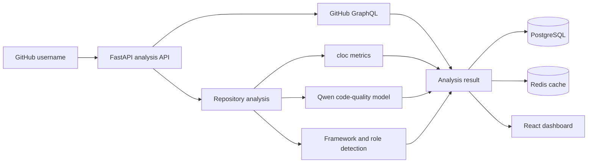

# DevLegacy

DevLegacy is a GitHub developer-profile analyzer. It combines repository activity, technology detection, documentation habits, source-code quality, and repository structure into a single developer profile, score, and role recommendation.

<p align="center">
  <a href="https://dev-legacy-lac.vercel.app/">Live demo</a> ·
  <a href="https://huggingface.co/sujalgawas/qwen2.5-coder-1.5b-code-reviewer">Fine-tuned model</a> ·
  <a href="https://huggingface.co/Qwen/Qwen2.5-Coder-1.5B-Instruct">Base model</a> ·
  <a href="./docs/">Documentation</a>
</p>

## What is DevLegacy?

DevLegacy answers a practical question: **what does a developer’s public GitHub work say about their engineering profile?**

The backend fetches public GitHub information, analyzes selected repositories, persists the results, and exposes them to the frontend. The frontend presents the result as an interactive dashboard, including a 3D experience built with React Three Fiber.

## How it works



## Capabilities

- GitHub profile, commit, contribution, issue, pull-request, and review metrics.
- Technology and framework detection from repository metadata and manifests.
- Code-quality scoring with a quantized Qwen2.5-Coder model.
- README and source-comment statistics.
- Repository file-structure scoring.
- Role recommendations such as frontend, backend, and full-stack development.
- Cached completed analyses and background processing for longer-running jobs.

## Get started

### Prerequisites

- Docker and Docker Compose
- Node.js and npm
- A GitHub token with the permissions required by the configured API calls
- A Hugging Face token if model assets are downloaded or accessed during setup

### Run the backend and services

1. Copy `backend/.env.example` to `backend/.env`.
2. Configure GitHub and Hugging Face credentials.
3. Add Firebase credentials at `backend/serviceAccountKey.json` if Firebase authentication is enabled.
4. Start the backend, PostgreSQL, and Redis:

   ```bash
   docker compose up --build -d
   ```

### Run the frontend

```bash
cd frontend
npm install
npm run dev
```

The live deployment is available at [dev-legacy-lac.vercel.app](https://dev-legacy-lac.vercel.app/).

## In this repository

| Area | Description |
| --- | --- |
| [`backend/app/api/`](./backend/app/api/) | FastAPI routes and analysis orchestration |
| [`backend/app/services/`](./backend/app/services/) | GitHub, model, `cloc`, file-structure, and recommendation services |
| [`backend/app/models/`](./backend/app/models/) | SQLAlchemy persistence models |
| [`frontend/`](./frontend/) | React/Vite dashboard |
| [`docs/`](./docs/) | Architecture and implementation notes |
| [`contribution.md`](./contribution.md) | Contribution workflow |

## Documentation

- [Architecture overview](./docs/architecture.md)
- [Database structure](./docs/database.md)
- [Role recommendation service](./docs/recommendation.md)
- [Code-quality service](./docs/codequality.md)
- [File-structure service](./docs/filestructure.md)
- [GitHub GraphQL integration](./docs/github-graphql.md)
- [CLOC integration](./docs/cloc.md)
- [Redis cache](./docs/redis.md)

## Contributing

Read the [contribution guide](./contribution.md) before opening a pull request.
