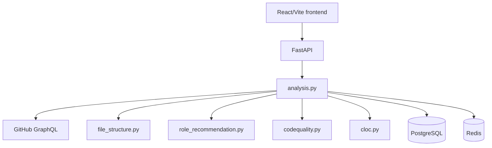

# Architecture

DevLegacy is split into a React frontend and a FastAPI backend. The backend coordinates the analysis workflow, calls GitHub, runs local analysis services, writes results to PostgreSQL, and returns a dashboard payload.

The main analysis runs as a background task. The client can start an analysis, poll its task status, and retrieve a cached completed result. This keeps expensive GitHub traversal and model inference out of the request-response path.

## Main technology choices

- **Frontend:** React, Vite, Tailwind CSS, React Three Fiber.
- **Backend:** FastAPI, SQLAlchemy, PostgreSQL.
- **Analysis:** Python, NumPy, scikit-learn, `cloc`, llama-cpp-python.
- **Operations:** Docker Compose, Redis, and optional ngrok tunneling.

For implementation details, see the individual service pages in this directory.
