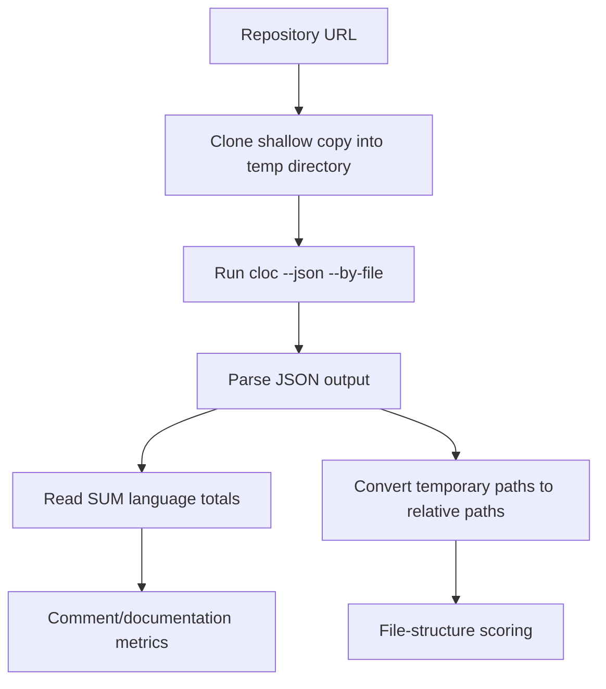

# CLOC integration

[`cloc.py`](../backend/app/services/cloc.py) uses the external **CLOC (Count Lines of Code)** command-line tool to calculate per-language source, comment, and blank-line metrics.

The clone and `cloc` commands have timeouts. Temporary repositories are removed automatically after processing. If cloning, execution, or JSON parsing fails, the service logs the failure and returns `None`, allowing the rest of the profile analysis to continue.
