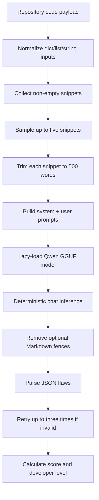

# Code quality service

The code-quality service is implemented in [`codequality.py`](../backend/app/services/codequality.py). It runs a local quantized GGUF model using llama-cpp-python.

## Model and scoring

- The configured local file is `backend/app/.cache/models/model_q4km.gguf`.
- The model is loaded only on the first inference request, reducing startup cost and avoiding an import-time crash when the model file is absent.
- Inference uses a CPU-oriented configuration (`n_gpu_layers=0`) and deterministic generation.
- The model is expected to return JSON containing a `flaws` array.
- Up to five sampled snippets are analyzed to keep latency and memory bounded.
- The service maps the resulting score to `Intern`, `Fresher`, `Mid`, or `Senior`.

The project model is [Qwen2.5-Coder-1.5B-Code-Reviewer](https://huggingface.co/sujalgawas/qwen2.5-coder-1.5b-code-reviewer), based on [Qwen2.5-Coder-1.5B-Instruct](https://huggingface.co/Qwen/Qwen2.5-Coder-1.5B-Instruct).
