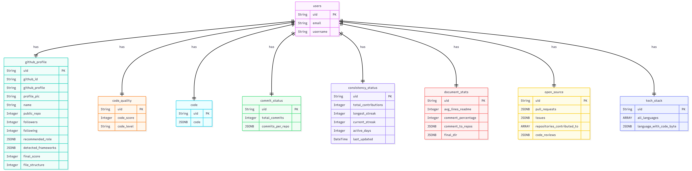
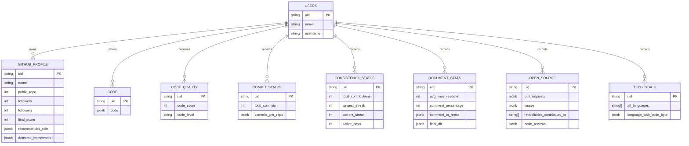

# Database

DevLegacy uses PostgreSQL through SQLAlchemy. Each analysis is keyed by the authenticated/user identifier (`uid`). Instead of one wide result table, the backend stores related result categories in separate tables. JSONB is used where the shape is naturally nested, such as repository counts, issues, detected frameworks, and code snapshots.

The image is the visual reference for the project schema. The Mermaid diagram documents the logical relationship: the tables are related by `uid`, even though the current model files primarily express those keys as independent primary-key columns rather than SQLAlchemy relationship declarations.
