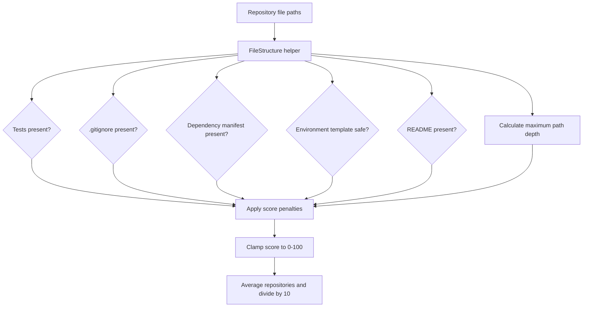

# File-structure scoring

The file-structure service is implemented in [`file_structure.py`](../backend/app/services/file_structure.py). It evaluates up to four repositories from the documentation/code-fetch result.

The checks reward a recognizable project layout and penalize missing tests, `.gitignore`, dependency management, README documentation, environment templates, or a useful directory depth. A committed `.env` is penalized more heavily than a missing template. The final helper returns an average score out of 10 for the selected repositories.
