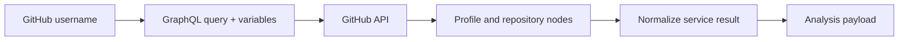

# GitHub GraphQL integration

GitHub GraphQL is the backend’s primary source of profile and repository data. The shared helper sends authenticated POST requests to `https://api.github.com/graphql`, while the service modules define focused queries.

The integration is used to fetch:

- commit totals and per-repository history;
- contribution-calendar streaks;
- pull requests, issues, reviews, and contributed repositories;
- languages and byte counts;
- source files and README statistics;
- profile metadata;
- framework evidence for role recommendations.

Repository trees are traversed with nested `Tree`/`Blob` fragments. Only supported source extensions and notebooks are retained for analysis. The service also handles failed requests, missing users, and malformed response sections by logging the failure and returning an empty result for that metric.
