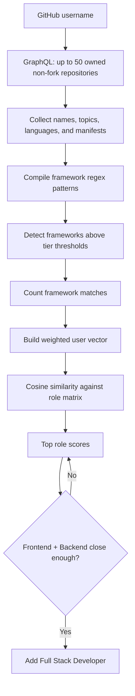

# Role recommendation

The role recommender is implemented in [`role_recommendation.py`](../backend/app/services/role_recommendation.py). It uses repository metadata and lightweight text matching rather than inspecting every source file.

## Step-by-step

1. The service sends one GitHub GraphQL request for up to 50 owned, non-fork repositories.
2. For each repository it combines the name, topics, detected languages, and the text of common manifests such as `package.json`, `requirements.txt`, `pom.xml`, `Cargo.toml`, and Docker files.
3. Pre-compiled regular expressions detect framework keywords. Framework tiers determine which frameworks are detectable and how many matches are required.
4. Detected frameworks are counted across repositories.
5. The counts become a weighted vector. That vector is compared with the framework matrix associated with each role using cosine similarity.
6. The top non-zero roles are returned with percentage-like scores. If frontend and backend scores are sufficiently close, a `Full Stack Developer` recommendation is added.

The public result contains `detected_frameworks` and `recommended_roles`. Network, GraphQL, or missing-user failures are logged and return an empty recommendation rather than stopping the complete analysis.
