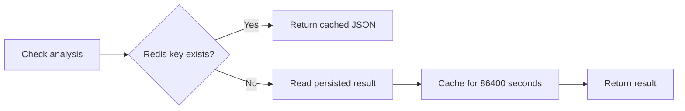

# Redis cache

Redis is used as a small response cache for completed analysis checks. The backend builds keys in the form `analysis_check:<github-username>`, stores the serialized response for 24 hours, and returns that value before starting duplicate work.

Docker Compose runs Redis as `redis:7-alpine`. The URL is configurable through `REDIS_URL`.
